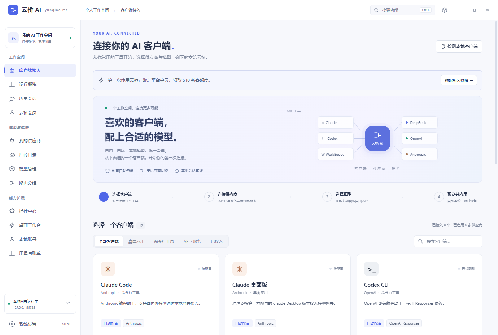

# 云桥 AI · yunqiao.me

**解锁桌面插件市场，把客户端、供应商、模型和历史会话放进一个中文工作空间。**

从你正在使用的客户端开始：选择 Claude Code、兼容的 ChatGPT 桌面版或 Codex CLI，连接自己的 API 供应商，选好模型，预览后应用。支持国内外模型服务与自定义中转地址，提供浅色、深色和跟随系统的界面。

[下载](https://github.com/jxb412/yunqiao.me/releases) · [安装说明](INSTALLATION.md) · [使用指南](USER-GUIDE.md) · [反馈问题](https://github.com/jxb412/yunqiao.me/issues) · [用户讨论](https://github.com/jxb412/yunqiao.me/discussions)

> 文档更新于 **2026 年 11 月 16 日**，介绍 **0.6.0** 的功能。Windows 与 macOS 构建产物将在 [GitHub Actions](https://github.com/jxb412/yunqiao.me/actions/workflows/build.yml) 成功完成后提供下载；正式 Release 与公开版本以[下载页](https://github.com/jxb412/yunqiao.me/releases)为准。旧版可能不包含下文全部功能。

## 能做什么

1. **插件市场解锁。** 为兼容的桌面客户端开放插件入口，浏览公开市场和完整索引，安装、更新与启停插件。提供中文界面、主题、模型分组、会话导出、历史轮次补全等增强，并显示每项插件是否真正生效。需要服务授权的插件仍按其要求登录。
2. **按客户端配置中转。** 先选客户端，再选或添加供应商和模型。向导支持已有配置发现、云端厂商预设、上游测试、本地网关测试、配置预览、自动备份和恢复；WorkBuddy、CodeBuddy、Kimi、OpenCode 和 Qwen 提供各自的手动接入步骤与示例。
3. **网关与直连任选。** 本地网关支持常用模型协议转换、多密钥轮换、路由分组和用量统计；符合条件时可直连供应商。兼容的 ChatGPT / Codex 编程客户端还可保留官方账号，与第三方模型共存。
4. **查看当前连接与权限。** 首页显示客户端、供应商、模型、可观测的最近成功请求和余额；桌面应用可重新启动，命令行工具可在新终端打开。支持的编程客户端可预览并单独恢复原执行权限，保留供应商连接。
5. **找回与整理历史。** 搜索、阅读和导出本机会话，区分主会话与子任务；对 Codex 编程会话提供供应商区域迁移、路径检查和消息索引修复，执行前可预览，执行后可按备份恢复。
6. **统一管理模型、余额和使用量。** 厂商目录优先展示 OpenAI、Anthropic、Google，再展示其他国际、国内、中转和本地服务。同步供应商模型，分页查找并批量编辑能力、价格与上下文；查询支持接口的供应商余额和各 Key 额度，查看实时请求、Token、缓存命中与估算费用。
7. **按自己的习惯使用。** 管理 MCP、Skills 与全局提示词，调整外观、托盘、自启、代理和网关设置，导入导出配置；通过远程控制台查看电脑上的工作空间。
8. **会员登录自动续期。** 用邮箱和密码登录、完成所需验证后，在平台支持时后台续期，无需因短期访问令牌到期而反复登录。页面会说明续期状态，手动绑定访问令牌的方式需到期后重新绑定；会员活动和额度以平台实时结果为准。

本地客户端识别、历史与资源扫描在后台进行，扫描期间可继续切换页面。模型列表分页展示，长会话分批显示并可展开完整消息；桌面工作台按当前标签读取内容，减少进入页面时的等待。

插件中心优先显示本地目录，返回页面时直接显示已缓存的列表，连接状态在后台更新。需要核对远端目录时点击“同步市场索引”；“刷新状态”用于重新检查本机连接和插件状态。

需要多家服务共同提供一个模型入口时，在 **路由分组** 创建分组并按 **接入参数** 配置客户端，模型名使用 `group/分组名`。可选依次、轮换、按权重、用得少的优先、额度余量优先、健康与优先级六种策略；生效条件与重试边界见[使用指南](USER-GUIDE.md#7-路由mcpskills-与提示词)。

## 第一次使用

1. 安装并打开云桥 AI，进入 **客户端接入**，点击目标客户端的 **开始配置**。
2. 选择已有供应商，或填写供应商给出的 API 地址、API Key 和模型。厂商目录可帮助填写预设。
3. 选择模型和接入方式。通常使用 **本地网关**；不需要网关功能时，可选择界面允许的 **直连供应商**。
4. 测试后点击 **预览配置**。自动配置的客户端点击 **备份并应用配置**；手动接入的客户端按专属指南选择版本、复制参数或配置示例，在原客户端完成设置。测试可能产生少量费用。
5. 重新启动客户端，发起一条对话。使用本地网关时，保持云桥 AI 运行。

要使用插件，保存工作并完全退出原客户端，在 **插件中心 → 桌面插件与市场** 顶部的 **插件市场解锁** 中点击 **启用并连接**。确认 **已生效** 后点击 **浏览插件市场**。完整操作见[使用指南](USER-GUIDE.md)。

## 支持哪些客户端

| 客户端 | 使用方式 |
| --- | --- |
| Claude Code | 自动配置 API 地址、密钥和模型，支持备份恢复 |
| Claude Desktop | 支持第三方推理配置的版本可自动接入；以本机检测结果为准 |
| Codex CLI | 自动配置 API、模型和上下文，可使用官方账号共存模式 |
| ChatGPT 桌面版 / 原 Codex 桌面版 | 支持 Codex 编程配置的版本可配置第三方模型；桌面插件按版本检测兼容性 |
| Gemini CLI | 自动配置 Gemini 接口和模型 |
| WorkBuddy / CodeBuddy | WorkBuddy 提供自定义模型界面步骤，CodeBuddy CLI / IDE 提供独立配置示例 |
| Kimi、OpenCode、Qwen Code | 提供对应协议、配置文件与启动步骤；OpenCode 区分 V1 / V2，Kimi 核对实际上下文容量 |
| DeepSeek API 与其他兼容客户端 | 生成标准连接参数，需在支持自定义 API 的应用中手动填写 |

桌面客户端的第三方 API 和插件能力以实际版本为准。应用配置后请重启客户端并发起对话验证；专属工具、思考内容和旧会话续聊能力也取决于模型与客户端。详细说明见[使用指南](USER-GUIDE.md)。

## 下载与安装

| 平台 | 0.6.0 构建包 |
| --- | --- |
| Windows x64 | 安装版 `win-x64-setup.exe`、免安装版 `win-x64-portable.exe`、完整解压版 `win-x64.zip` |
| macOS Apple Silicon | `mac-arm64.dmg`，适用于 Apple M 系列芯片 |
| macOS Intel | `mac-x64.dmg`，适用于 Intel 处理器 |
| iPhone / iPad | 目前没有可直接安装的正式 App，可通过浏览器连接电脑端 |

在 [GitHub Actions](https://github.com/jxb412/yunqiao.me/actions/workflows/build.yml) 中选择成功完成的构建，下载 Windows 或对应芯片的 macOS 产物；正式安装包以[下载页](https://github.com/jxb412/yunqiao.me/releases)公布为准。Actions 下载的外层压缩包需先解压，具体文件名和步骤见[安装说明](INSTALLATION.md)。

Windows ZIP 版需完整解压后双击同目录的 `YunQiaoAI.exe`；portable 启动会显示准备提示。macOS 将应用拖入“应用程序”，未签名包的首次打开方法见[安装说明](INSTALLATION.md#安装和首次打开)。更新或切换包形式会保留已有本机数据。

电脑端已运行时，可用手机浏览器访问远程控制台。局域网连接方法见[使用指南](USER-GUIDE.md)。

## 数据与反馈

供应商密钥和配置保存在本机。云端目录提供公开的厂商信息；模型请求发送到你选择的服务。导出的配置包含密钥，请妥善保管。余额以供应商返回为准，用量费用按配置价格估算。

遇到问题可提交[问题反馈](https://github.com/jxb412/yunqiao.me/issues)。请提供云桥版本、系统、客户端名称和版本、所选接入方式及错误提示，并遮住 API Key、访问令牌和个人会话内容。

本项目按 [AGPL-3.0-only](LICENSE) 开源。[查看源码](https://github.com/jxb412/yunqiao.me) · [第三方许可](THIRD_PARTY_NOTICES.md)
