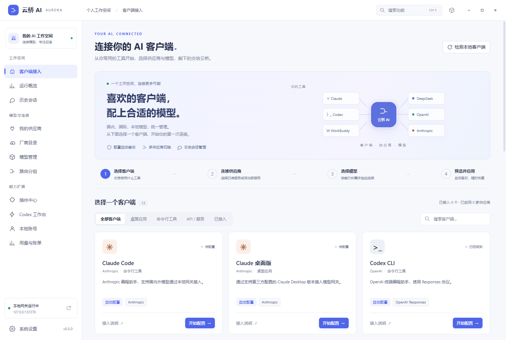

# 云桥 AI · Aurora

以客户端为起点的 AI 工作空间：**选客户端 → 连接供应商 → 选择模型 → 预览并应用**。

Windows 桌面端使用 Electron + React + TypeScript；iOS 为 Capacitor 伴侣端，连接电脑或服务器上的网关。当前版本 0.5.0。

公开仓库：[jxb412/aurora](https://github.com/jxb412/aurora) · [构建与下载](https://github.com/jxb412/aurora/actions) · [用户讨论](https://github.com/jxb412/aurora/discussions)



## 已实现

- **客户端工作台**：分类、搜索、本地检测；向导内新增供应商、拉取远端预设、选择模型、测试连接、查看脱敏配置差异、自动备份、恢复原配置。
- **厂商与供应商**：公开远端目录、国内/国际/本地/聚合筛选、批量导入、离线缓存、自定义 API、多个密钥、禁用和冷却。
- **模型管理**：同步服务商模型列表、原始模型 ID、上下文和价格元数据、工具/视觉/思考能力标注。
- **本地网关**：Anthropic Messages、OpenAI Chat、OpenAI Responses、Gemini；同协议原生透传，跨协议转换；分组路由、重试和请求统计。
- **历史会话**：只读扫描 Claude Code、Codex、Gemini 等支持格式，搜索、按客户端过滤、阅读、Markdown 下载、复制对应客户端恢复命令。
- **扩展**：内置请求插件、自定义中间件；Codex Skills、MCP、插件与提示词资源发现、支持项启停、全局指令编辑、会话诊断。
- **设置**：浅色/深色/跟随系统、强调色、托盘、自启、网关与代理、访问令牌、远端目录、更新检查、导入导出配置。
- **远程管理**：认证后的 Web 控制台与 iOS 内置伴侣 UI；公开目录不包含个人密钥，远程管理返回值脱敏。

## 客户端能力

| 客户端 | 当前接入方式 |
| --- | --- |
| Claude Code | 自动配置 settings.json，保留其他设置 |
| Claude Desktop | 支持第三方配置的版本：写入 Claude-3p profile；具体平台/版本须支持该入口 |
| Codex CLI / Codex 桌面版 | 自动配置共享的 Codex 配置，正确写入 TOML 顶层键与供应商表 |
| Gemini CLI | 自动配置环境文件，使用原生 Gemini 网关接口 |
| WorkBuddy / DeepSeek API / Qwen / Kimi / OpenCode 等 | 按能力给出手动参数与文档；不猜测未证实的配置文件，也不把手动参数标记成自动接入成功 |
| ChatGPT 桌面聊天 | 官方账号登录；未发现可把任意第三方 API 替换为其订阅聊天的受支持机制 |

客户端界面会展示自动配置、手动接入或官方登录状态，以及版本限制。厂商同名模型也可能具有不同能力，连接测试需要用户自己的有效 API Key。

## 使用与构建

安装依赖后：

```powershell
pnpm install --frozen-lockfile
npm run dev
npm run build
npm run package:win
```

Windows 产物位于 `release/`：`YunQiaoAI-0.5.0-win-x64-setup.exe` 与 `YunQiaoAI-0.5.0-win-x64-portable.exe`。未配置代码签名证书。

无界面网关：

```powershell
npm run build
node dist/main/gateway-cli.cjs --data ./gateway-data --port 3425
```

令牌保存在该数据目录的 `settings.json`。Web 控制台与模型接口都需要令牌，API 使用 `Authorization: Bearer <gatewayToken>`；Anthropic/Gemini 兼容各自密钥头。公共 `/health` 只显示服务健康信息。

模型路由支持 `模型ID`、`供应商ID/模型ID`、`group/分组名`。向导写入明确供应商 ID，避免选好供应商后请求被同名模型误路由。

## iOS

见 [移动端说明](mobile/README.md)。移动界面内置于 App，可查看和管理已连接电脑上的客户端、供应商、会话及用量；API Key 留在电脑端，手机访问令牌仅保留当前运行会话。

```bash
cd mobile
npm ci
npm test
npm run sync:ios
npx cap open ios
```

原生编译必须使用 **macOS + Xcode**。仓库工作流在 macOS 上构建模拟器 `.app`，不会把源码或模拟器 ZIP 伪称可安装到 iPhone 的 IPA。真机分发还需要 Apple 开发者签名和描述文件。当前 Windows 工作区能生成 iOS 工程、构建 Web 资源，不能独立完成苹果原生编译。

2026-11-15 已通过 [GitHub macOS 原生构建](https://github.com/jxb412/aurora/actions/runs/43617523329/job/132515739714)，产出包含有效 Mach-O 的 iOS 16+ 模拟器应用；另提供 iPhoneOS 未签名设备构建流程。Actions 手动运行可选 `ios`、`windows` 或 `all`。

## 验证

```powershell
npm run typecheck
node scripts/test-clients.mjs
node scripts/test-gateway.mjs
npm run build
node scripts/smoke.mjs
python scripts/test-ui.py
```

客户端测试使用隔离的临时 home；网关测试使用本地模拟上游。UI 测试需要 Python Playwright，使用 Electron 与隔离数据目录，验证实际的配置、恢复、会话下载和认证流程。它们不会证明所有服务商或所有客户端版本都已通过真实付费 API 联调。

## 当前边界

- 同协议原生路径尽量保留供应商专属字段。开启转换、隐私遮蔽或通用请求插件后，专属 hosted tools、加密 reasoning 和部分多模态能力不保证跨协议可用；不同供应商的思考签名不能伪造。
- 历史可阅读不等于可以跨账号无损续聊。读取有大小/消息数量边界；没有永久后台全文索引。
- 用量费用依据本地价格估算，额度策略依据已配置额度，不等同实时官方账单。
- 扩展管理目前覆盖内置中间件和已安装的 Codex 本地资源；跨客户端扩展市场、WSL 多配置环境、加密云同步属于后续设计，未展示为已实现功能。
- 远程管理限制文件写入、自定义代码、密钥与敏感设置；这些操作需要桌面端完成。

## 设计与来源

[真实用户需求调研](docs/RESEARCH.md) · [产品与实现设计](docs/DESIGN.md) · [目录服务部署](docs/SERVER.md)

参考 CodexPlusPlus、cc-switch、magpie 的公开功能和用户讨论进行设计。本次没有把三个项目的代码库直接合并。后续引入第三方源码时需要分别遵守其许可证。
